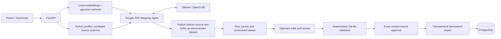
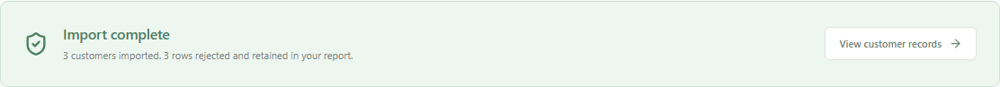

# DataBridge

DataBridge is an AI-assisted CSV onboarding application that proposes schema mappings using retrieved policy documentation, validates records deterministically, and imports approved data through transactional, retry-safe workflows.

Built for an operator importing customer files with unfamiliar column names, inconsistent categories and invalid values. Local AI reduces the header/policy lookup work while the operator controls the mapping and import.


**React + TypeScript / FastAPI / PostgreSQL + pgvector / Google ADK / Ollama**

## A concrete import

Northstar is a fictional subscription company. A source file might contain:

```csv
full_name,email_address,joined,plan,country
 Maya Chen ,maya.chen@example.com,2025-01-14,professional,US
Oliver Reed,not-an-email,2025-01-23,pro,GB
```

The operator maps full_name to name, selects YYYY-MM-DD and confirms the documented professional-to-pro pair. Validation trims the name and accepts Maya's record; Oliver's invalid email stays in the rejected-row report. The supplied six-row sample produces **3 accepted and 3 rejected rows** on an empty destination after those explicit transformations.

## Try the category preview

1. Start real local AI and ingest the policies using the commands below.
2. Upload [category-preview.csv](samples/category-preview.csv) and select **Suggest mapping**. Open **Tier source coverage** to compare `membership_band` (3/4 supported) with `plan` (0/4, billing cadence). Confirm that the tier source is `membership_band`.
3. In **Category transformation preview**, inspect `professional` to `pro`, its policy citation, and the two affected rows. The preview shows `gold` as unresolved. Documented lookup adds alias rules without a second model call.
4. Confirm the sources, leave country unmapped if absent, and explicitly select DD/MM/YYYY for this sample. Edit the category pairs in the mapping table as needed. Save and validate. On a fresh destination, the documented pair yields three valid rows and one rejected row. Approve that validation to import.

### Why profiles are the default

The original eight labeled cases compared tier selection and explicit abstention:

| Workflow at that measurement | Correct tier decisions | Label-inferred source edits | Model calls | Median workflow |
|---|---:|---:|---:|---:|
| Former conditional two-agent default | 3/8 | 5 | 10 | 12.80 s |
| Mapping Agent + lookup | 3/8 | 5 | 8 | 12.09 s |
| Upfront profiles + lookup | 7/8 | 1 | 8 | 12.19 s |

The 0.10 s median difference between the two lookup variants is an observation from this small run. Source edits are mismatches against labeled final field assignments. The measured workflows did not involve operators making edits. The release replay reached 8/8 correct tier decisions with zero inferred edits. On five fresh cases it reached 5/5 with zero inferred edits. Both lookup workflows made one model call per file. [Original and follow-up results](docs/evaluation.md#promoting-upfront-profiles).

In the real billing-plan replay, plain lookup selected `plan`, and its preview showed zero affected rows and three unresolved values. The profiled call saw `plan` at 0/3 supported rows and `benefit_code` at 3/3. It chose `benefit_code`, and lookup applied `professional → pro` to one row with zero unresolved values. Each workflow made one model call.

## How it works

1. Upload a bounded UTF-8 CSV and inspect its original rows.
2. Retrieve relevant schema/policy chunks from PostgreSQL using local query embeddings.
3. Profile each source column for canonical tiers and documented aliases before the Mapping Agent call. Apply exact documented alias lookup to the accepted tier source. The operator selects the source when evidence is weak, tied, or disagrees with the model.
4. Edit source choices, category pairs and date format. Null date format explicitly requests human selection.
5. Validate the entire file with Python rules and preview original/transformed values.
6. Approve the exact file, mapping version and validation result, with the valid-rows-only policy.
7. Import accepted records in one transaction. Keep rejected rows available for download.

## Architecture



Ollama runs separately on the Windows host. Application services run in Docker. Nomic embeddings run on CPU; generation uses the configured local model. The AI path produces mapping data. Application code owns validation, approval and customer writes.

## Engineering decisions

- **Bounded proposals.** Pydantic permits source selection, trim, explicit dates and category pairs. Generated code and SQL are never executed.
- **Authoritative constraints.** Required/optional status and value rules come from the destination schema. A present optional country must be valid; retrieved prose and model concerns cannot change that rule.
- **Exact approvals.** A mapping/date edit clears validation and approval. Execution rechecks the approved version and file/mapping/validation hashes.
- **Retry-safe writes.** Locks, unique normalized emails, conflict rechecks and persisted idempotency results prevent duplicate effects. Existing customers are rejected rather than updated.
- **Upfront profiles and deterministic aliases.** The Mapping Agent receives counts for up to 12 ranked columns. Python requires sufficient tier coverage and a clear lead, then looks up exact aliases in the retrieved policy. The preview shows supporting policy, affected rows and unsupported values.
- **Inspectable traces.** Sanitized application inputs, parsed outputs, guards, validator results and nested timings distinguish model behavior from Python enforcement. [Small real trace example](docs/examples/local-mapping-trace.json).

## Quick start

Docker Desktop with its Linux engine and Git are required. The database extension and migrations are applied during API startup. There is no default application account.

### Manual/mock mode

No model download, GPU or cloud account is needed. Mock suggestions use deterministic fixtures and lexical retrieval.

**Bash**

```bash
git clone https://github.com/kaushik945/DataBridge.git
cd DataBridge
cp .env.example .env
docker compose up --build -d
```

**PowerShell**

```powershell
git clone https://github.com/kaushik945/DataBridge.git
cd DataBridge
Copy-Item .env.example .env
docker compose up --build -d
```

For an existing checkout, keep its .env and database volume. Wait for [API health](http://localhost:8000/api/health) to return status ok and mode mock, then run these commands in either shell:

```sh
docker compose exec api python -m app.cli setup-operator --username operator
docker compose exec -T api python -m app.cli ingest
```

The provisioning command securely prompts for a password of at least 12 characters. It runs once for the single operator account. Open **http://localhost:5173**, sign in and upload [northstar-customers.csv](samples/northstar-customers.csv). Inspect suggestions, explicitly select the date format, validate and approve. Prior imports can produce destination-email conflicts.

### Real local AI on Windows

The verified configuration uses an RTX 4050 Laptop GPU with 6 GB VRAM and 16 GB RAM. Hardware-dependent performance and model errors remain visible. Install [Ollama for Windows](https://ollama.com/download/windows), quit any auto-started tray server, then start the repository's loopback-only, cloud-disabled server.

**PowerShell, from the clone**

```powershell
powershell.exe -ExecutionPolicy Bypass -File .\scripts\start-ollama.ps1
ollama pull qwen3:4b
ollama pull nomic-embed-text:v1.5
docker compose -f compose.yaml -f compose.local.yaml up --build -d
docker compose -f compose.yaml -f compose.local.yaml exec -T api python -m app.cli local-diagnostics
docker compose -f compose.yaml -f compose.local.yaml exec -T api python -m app.cli ingest
```

Run start-ollama.ps1 only when its service is stopped. If ollama is not on PATH, use the installed executable shown in [setup](docs/setup.md). Downloads are approximately 2.5 GB and 274 MB. Local mode uses real embeddings and generation, has no remote/mock fallback and needs no AI API key. It has no external AI API charges; hardware and electricity still have costs. A fresh local-only setup also needs the operator provisioning command above.

The upload endpoint defaults to `TIER_MAPPING_STRATEGY=profile_lookup`. For an explicit local comparison, set `TIER_MAPPING_STRATEGY=agent` in the ignored `.env` and recreate the API. Set it back to `profile_lookup` to restore the default. The evaluator selects variants directly. The [setup guide](docs/setup.md) covers networking, model identity and reindexing.

### Shutdown

```sh
# Manual/mock profile
docker compose down
# Local profile
docker compose -f compose.yaml -f compose.local.yaml down
```

These commands retain database data. Ollama is a separate process. Adding --volumes to down permanently deletes the selected project's database volume.

## Screens from the running application

The images use an isolated demo account and synthetic CSV data. The mapping screenshot is from real local Qwen3 execution; operator edits precede validation/import. [Open the retrieved policy passage](docs/images/mapping-evidence.png).

| Full-file validation | Accepted/rejected import outcome |
|---|---|
|  |  |

## Tests and measured results

Backend checks use a dedicated databridge_test database. Frontend checks require Node.js 24. Set browser credentials to the account you provisioned, as described in [CONTRIBUTING](CONTRIBUTING.md).

```sh
# Create once
docker compose exec -T db createdb -U databridge databridge_test
docker compose exec -T -e AI_MODE=mock -e ALLOWED_ORIGINS=http://localhost:5173 -e DATABASE_URL=postgresql+psycopg://databridge:local-development-only@db:5432/databridge_test api python -m pytest -q
docker compose exec -T api ruff check app tests
cd frontend
npm ci
npm run format:check
npm run typecheck
npm run build
npx playwright install chromium
npm run test:e2e
```

PowerShell uses npm.cmd/npx.cmd where execution policy requires it. The browser suite checks that the running API is in mock mode before making suggestions. Real-model tests are explicitly opt-in. CI uses disposable operator credentials, synthetic data and no GPU/private credentials.

Profiling verification passed 159 backend tests in the local-dependency image, five mock browser workflows, and two real Ollama browser checks covering the upload, preview, and import retries. [Verification and evaluation details](docs/evaluation.md).

In five historical category cases, documented lookup, a single agent and conditional delegation each found 5/5 expected pairs. Python rejected ten single-agent proposals. [Historical category comparison](docs/evaluation.md#category-preview-comparison).

Reproduce the new source comparison after starting the local stack and ingesting policy:

~~~sh
docker compose -f compose.yaml -f compose.local.yaml exec -T api python -m app.category_evaluation --suite fresh --variants lookup profile_lookup --output /tmp/tier-original-eight.json
docker compose -f compose.yaml -f compose.local.yaml exec -T api python -m app.category_evaluation --suite holdout --variants lookup profile_lookup --output /tmp/tier-fresh-five.json
~~~

The first command uses the eight now-known regression cases. The second uses the five cases added for this release. Add two_agents to --variants to measure explicit conditional delegation.

The earlier Investigator/Reviewer comparison and fixed-input timing profile remain in the [evaluation history](docs/evaluation.md#frozen-16-case-comparison).

## Scope and limitations

The verified deployment is local. The destination is one fixed customer schema and input is bounded UTF-8 CSV. Models can make semantic mistakes, so human review is mandatory. Slash dates always require operator selection, including individually unambiguous slash values. Latency depends on hardware, process/model initialization, cache state and input. The small synthetic evaluation does not establish broad enterprise accuracy.

Cloud container/Terraform configuration is prepared but cloud generation and deployment remain unverified. No cloud resources or billing are needed for the local profiles. Password reset, retention management and production operations are outside this prototype's current scope.

## Documentation

- [Setup and operating modes](docs/setup.md)
- [Architecture and trust boundaries](docs/architecture.md)
- [Evaluation and debugging case study](docs/evaluation.md)
- [Troubleshooting](docs/troubleshooting.md)
- [Three-minute demo](docs/demo-script.md)
- [Technical interview guide](docs/interview-guide.md)
- [Prepared cloud configuration](docs/deployment.md)
- [Contributing and checks](CONTRIBUTING.md)

## License

A project license has not been selected. Public visibility alone does not grant an open-source license. [GitHub licensing guidance](https://docs.github.com/en/repositories/managing-your-repositorys-settings-and-features/customizing-your-repository/licensing-a-repository).
